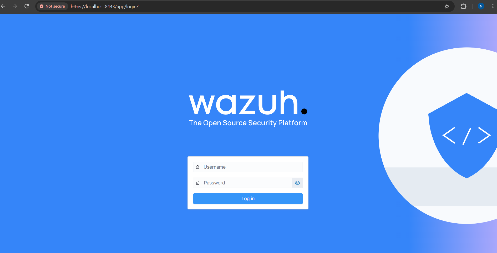
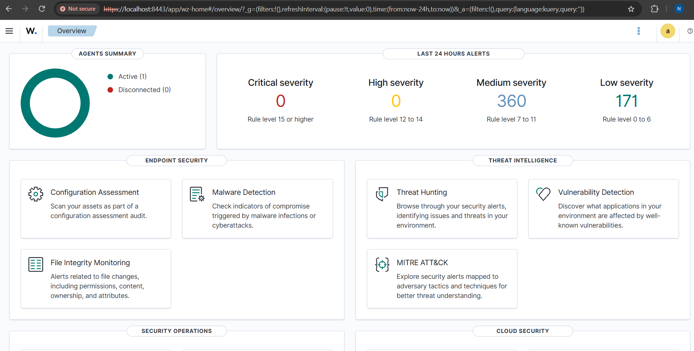
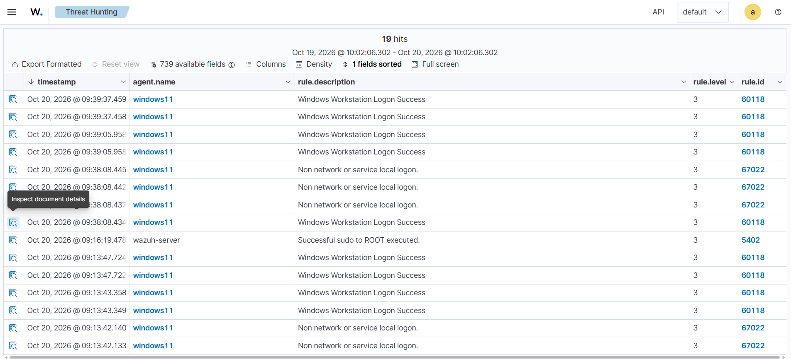
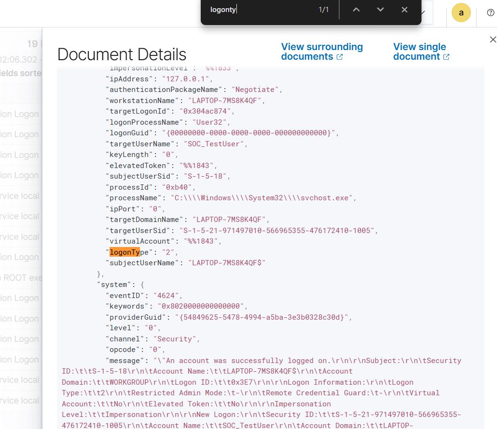
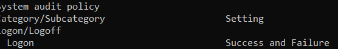
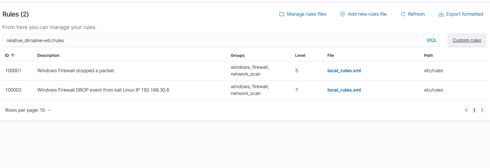
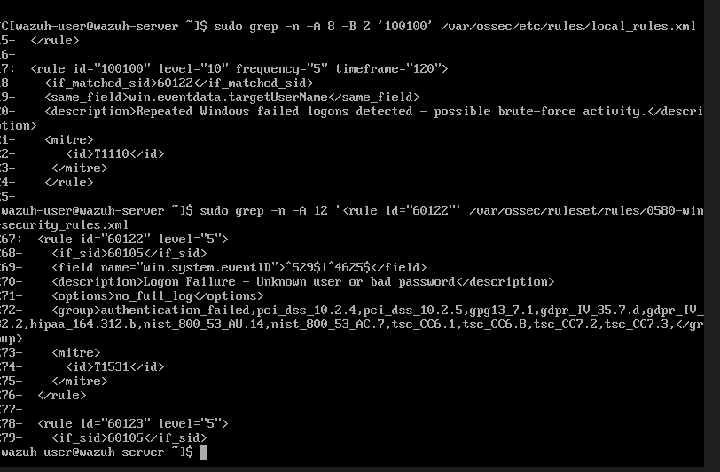
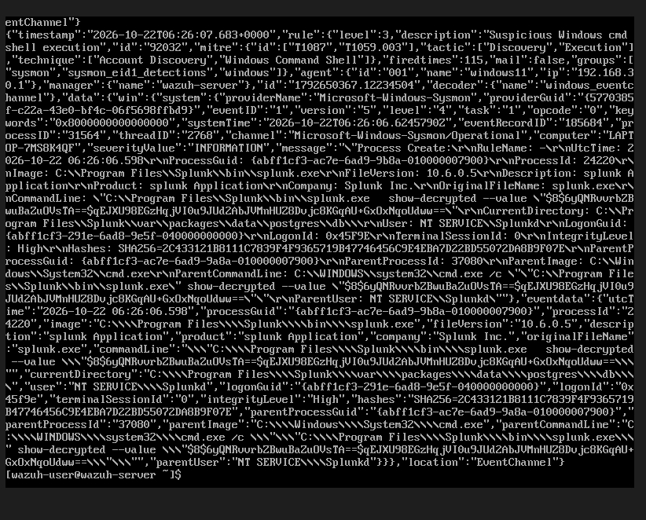
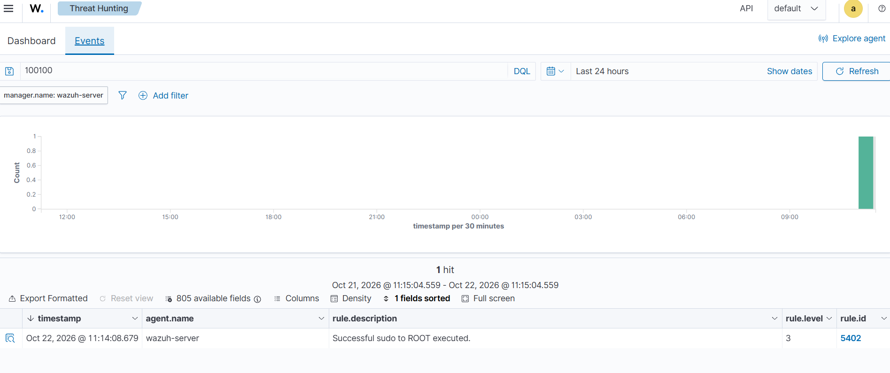
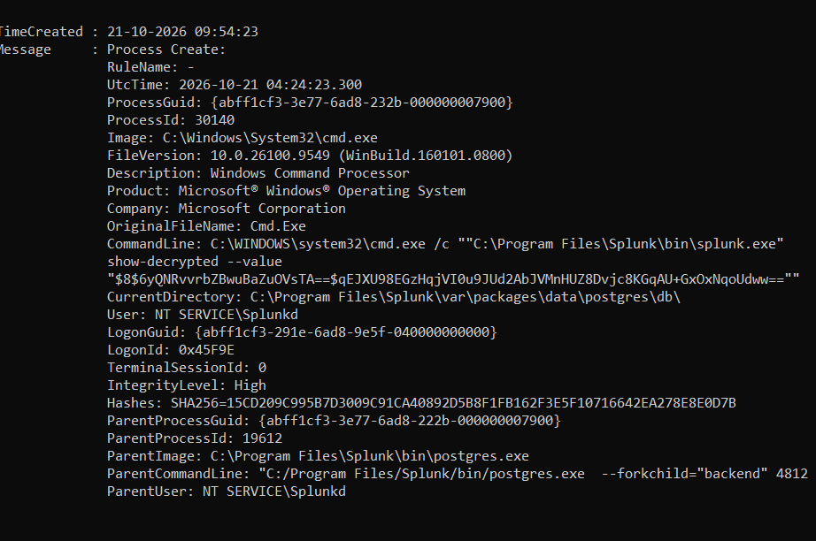

# Wazuh-SOC-Monitoring-Lab
Windows attack simulation, Wazuh SIEM monitoring, security alert investigation, and custom detection rule testing.

# Windows Attack Simulation and SIEM-Based SOC Monitoring & Detection Improvement Lab

## Project Overview
This personal cybersecurity lab focuses on Windows endpoint monitoring, SIEM alert investigation, and custom detection rule testing using Wazuh.

## Objectives
- Monitor Windows security events using Wazuh.
- Investigate failed logon attempts.
- Monitor process creation events using Sysmon.
- Test custom Wazuh detection rules.
- Document alert evidence and investigation findings.

## Lab Environment
- SIEM: Wazuh 4.14.9
- Target endpoint: Windows 11
- Testing system: Kali Linux
- Endpoint telemetry: Sysmon
- Virtualization: Oracle VirtualBox

## Detection and Investigation
### 1. Failed Windows Logon
- Windows Event ID: 4625
- Wazuh rule: 60122
- Investigation focus: failed authentication events and associated account details.

### 2. Process Creation Monitoring
- Sysmon Event ID: 1
- Purpose: review process creation activity on the Windows endpoint.

### 3. Custom Detection Rules
- Rule 92027: PowerShell process spawned a PowerShell instance.
- Rule 92032: Suspicious Windows command-shell execution.
- Rule 92052: Windows command prompt started by an abnormal process.

These rules were tested in the lab. Detection results and supporting evidence should be documented in the repository.

## Investigation Workflow
1. Generate a controlled lab test event.
2. Review the event in Windows logs and/or Sysmon.
3. Inspect the corresponding Wazuh alert.
4. Examine the rule ID, severity, timestamp, and event details.
5. Record findings and validate detection behavior.

## Evidence
Screenshots and investigation notes will be added after sensitive information is removed.

## Skills Practised
- SIEM monitoring and alert investigation
- Windows security event analysis
- Sysmon process monitoring
- Custom Wazuh detection rule testing
- Controlled security testing
- Technical documentation

## Project Evidence

### 1. Wazuh Dashboard Login

### 2. Wazuh Dashboard Overview

### 3. Wazuh Security Alerts

### 4. Windows Event Investigation

### 5. Windows Logon Audit Policy

### 6. Custom Wazuh Rules Dashboard

### 7. Custom Rules Terminal Evidence

### 8. Windows Event Log Evidence

### 9. Wazuh Alert Investigation

### 10. Sysmon Process Event

## Disclaimer
This project was conducted in a personal lab environment for educational purposes. Testing was limited to systems under my control.
